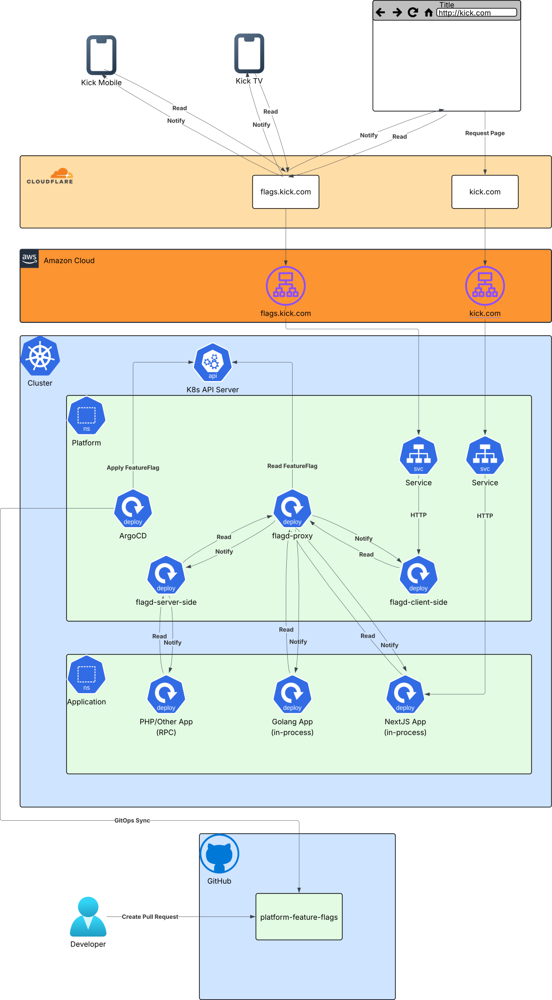

<br />
<div align="center">
  <a href="https://github.com/KickEngineering/platform-feature-flags">
    
  </a>

  <h3 align="center">platform-feature-flags</h3>

  <p align="center">
    Feature Flag management!
    <br />
  </p>
</div>

## About
Feature Flags are cool.


- [About](#about)
- [Links](#links)
- [Architecture](#architecture)
- [Usage](#usage)
  - [Client Side](#client-side)
    - [Mobile](#mobile)
    - [Web](#web)
  - [Server Side](#server-side)
    - [PHP](#php)
    - [Golang](#golang)
    - [NextJS](#nextjs)
- [Structure](#structure)

## Links

| Environment   | URL                                                                      | Configuration                                                                                                   |
| :------------ | :----------------------------------------------------------------------- | :-------------------------------------------------------------------------------------------------------------- |
| Production    | [https://flags.kick.com](https://flags.kick.com)                         | [Production](https://github.com/KickEngineering/platform-feature-flags/tree/main/k8s/flags/overlays/production) |
| Staging       | [https://flags.easygo-drop-kick.com](https://flags.easygo-drop-kick.com) | [Staging](https://github.com/KickEngineering/platform-feature-flags/tree/main/k8s/flags/overlays/staging)       |
| Preproduction | TBA                                                                      | TBA                                                                                                             |
| Development   | TBA                                                                      | TBA                                                                                                             |


## Architecture



## Usage
Consumption of feature flags is done through the OpenFeature specification, which allows for a consistent way to manage feature flags across different platforms and avoids vendor lock-in.

### Client Side
For consumers that run in an insecure environment, such as a web browser or mobile app, feature flag evaluation has to be done on a backend that is controlled by us. This is due to flag definitions having the potential to contain sensitive information that should not be exposed to end users. Only one options is available for client-side, which is remote evaluation using the client-side deployment of FlagD that is accessible via a publically exposed endpoint.

#### Mobile
TODO

#### Web

The browser starts with the flag values that were rendered by the Next.js server (see the **NextJS** section below). Immediately after hydration it bootstraps OpenFeature and subscribes to **streaming updates** from FlagD. When a flag definition in the `web-client` source changes, FlagD sends an [[Server-Sent Event (SSE)](https://developer.mozilla.org/en-US/docs/Web/API/Server-sent_events)] to the browser and the SDK updates its cached values.

**High-level flow**

```text
Next.js server ── initial flag values (SSR) ─▶ Browser
Browser ── streaming updates ─▶ FlagD (`web-client`)
```

**Browser bootstrap (React / OpenFeature)**

```ts
import { OpenFeature } from '@openfeature/react-sdk';
import { FlagdWebProvider } from '@openfeature/flagd-web-provider';

await OpenFeature.setProviderAndWait(
  new FlagdWebProvider({
    url: 'https://flags.kick.com',
    tls: true,
  }),
);

const client = OpenFeature.getClient();

const webTestEnabled = client.getBooleanValue('web-test', false);
```

When adding a new flag:

- **Default (recommended):** Add the flag to `kick-web` only. All `kick-web` values can be hydrated into the browser during SSR, so the client can still read them via React props, context or initial state.
- **Real-time browser toggle required?** If the flag must change **after** hydration (for example a kill-switch or UX experiment that needs instant reaction without a page reload) ➜ also add it to `kick-web-client`. This lets the browser subscribe to SSE updates for that specific key.

### Server Side
For consumers that do support it, we recommend inprocess evaluation of feature flags, which is the fastest and most efficient way to consume them. For consumers that do not support inprocess evaluation, we recommend remote evaluation using the server-side deployment of FlagD.

#### PHP
Kubernetes
```yaml
metadata:
  annotations:
    openfeature.dev/enabled: "true"
    openfeature.dev/inprocessconfiguration: platform-open-feature/backend-inprocess-config
```

Code
```
TODO
```

#### Golang

Kubernetes
```yaml
metadata:
  annotations:
    openfeature.dev/enabled: "true"
    openfeature.dev/inprocessconfiguration: platform-open-feature/backend-inprocess-config
```

Code
```golang
	flagDProvider, err := flagd.NewProvider(
		flagd.WithInProcessResolver(),
	)
	if err != nil {
		slog.Error("Failed to initialize FlagD provider", "error", err)
		os.Exit(1)
	}

	err = openfeature.SetProviderAndWait(flagDProvider)
	if err != nil {
		slog.Error("Failed to setup OpenFeature", "error", err)
		os.Exit(1)
	}

	client := openfeature.NewClient("template-demo")

	state := config.State{
		Flags: client,
	}
```

#### NextJS
Kubernetes
```yaml
metadata:
  annotations:
    openfeature.dev/enabled: "true"
    openfeature.dev/inprocessconfiguration: platform-open-feature/backend-inprocess-config
```

Flags in Next.js are evaluated *server-side* in line with [Flags SDK's server-side guidance](https://flags-sdk.dev/principles/server-side-vs-client-side). This avoids layout shift, reduces latency in hydrating components, and prevents leaking flag names to the browser.

##### 1 – OpenFeature ⇄ flagd adapter
```ts
// libs/shared/src/feature-flags/adapter.ts
import { OpenFeature } from "@openfeature/server-sdk";
import { createOpenFeatureAdapter } from "@flags-sdk/openfeature";
import { FlagdProvider } from "@openfeature/flagd-provider";

export const openFeatureAdapter = createOpenFeatureAdapter(async () => {
  const provider = new FlagdProvider(); // in-process resolver
  await OpenFeature.setProviderAndWait(provider);
  return OpenFeature.getClient();
});
```

##### 2 – Declare typed flags
```ts
// libs/shared/src/feature-flags/flags.ts
import { flag } from "flags/next";
import type { EvaluationContext } from "@openfeature/server-sdk";
import { openFeatureAdapter } from "./adapter";

export const webTest = flag<boolean, EvaluationContext>({
  key: "web-test",
  defaultValue: false,
  adapter: openFeatureAdapter.booleanValue(),
});
```

##### 3 – Use flags in a **Server Component** (App Router)
```tsx
// app/page.tsx – or any React Server Component
after using the app router.
import { webTest } from "@/lib/flags";

export default async function Page() {
  const isEnabled = await webTest();

  return <div>{isEnabled ? "Enabled" : "Disabled"}</div>;
}
```

The adapter pattern above follows the setup in [Flags SDK's flagd provider docs](https://flags-sdk.dev/providers/openfeature/flagd). After the initial render the server does **not** push updates; the browser continues listening to FlagD for changes (see Web section above).

## Structure

```
k8s
├── kustomization.yaml
├── environments.yaml
├── flags
│   ├── base
│   │   ├── kustomization.yaml
│   │   └── ...
│   └── overlays
│       ├── production
│       │   ├── kustomization.yaml
|       |   └── ...
│       └── staging
│           ├── kustomization.yaml
|           └── ...
└── ...
```
